  

### whoami

I'm not great at this part. Ask me about architecture and I'll talk for an hour; ask me to write an intro and I'll stare at the cursor.

Short version: I'm a software engineer from Cali, Colombia. I build backend systems — fintech services where the data is money and the failures are expensive, institutional platforms thousands of students depend on, and the occasional ML pipeline where "approximately right" isn't good enough.

I graduated Magna Cum Laude in Software Systems Engineering from Universidad ICESI — ten semesters in nine, mostly out of impatience.

### What I'm building

- **SIDEA** · Universidad ICESI — the platform that follows each student through their degree and flags at-risk cases early, so support teams know where to look before it's too late. `Spring Boot` `React` `Oracle`
- **Methodus** · contract — an adaptive ICFES prep platform built with a five-person team. I own the architecture, the release planning and the QA for the pilot. `React` `Next.js` `PostgreSQL`

### Things I've built

- **[Waycairn](https://github.com/Andrewdpg/waycairn)** · [npm](https://www.npmjs.com/package/waycairn) — a local-first MCP server that turns architecture docs into a byproduct of agent-assisted coding. Diagrams versioned in git, no backend, no auth, nothing to host. The idea came from being tired of documenting systems nobody reads.
- **[txbox](https://github.com/Andrewdpg/txbox)** — a transactional inbox for at-least-once delivery in Rust. The message and the effect commit together, or neither does. It exists because I kept seeing the same duplicated-event bug in different codebases.
- **[Pre-anesthetic screening](https://andrewpg.me/#projects)** — my thesis with Fundación Valle del Lili: an Airflow pipeline that normalizes clinical records and trains probabilistic models, plus a FastAPI service that scores patient risk in real time.

Before that: fintech at **Swiset**, across 8+ services, five broker integrations and two real-time pipelines — and I spent a good part of it killing race conditions.

### Off the clock

AURORA has been on repeat for years. Also Tom Odell, Lewis Capaldi, Kodaline, Olivia Rodrigo — I'm a bit of a romantic underneath it all, and the music gives it away immediately.

Outside of code: **The Last of Us** and the **Assassin's Creed** saga are the games I keep coming back to, and I'll watch anime of basically any genre — slice of life, shonen, isekai, romcom.

I'm quieter than I sound in writing. I'd rather listen first, then say something worth saying.

  
  
  

<b>Toolbox</b>

 

 

 

### Find me

  
  
  

Most of what I build comes down to the same thing: staying curious, wanting it to actually matter, and making sure the people who bet on me don't regret it.
